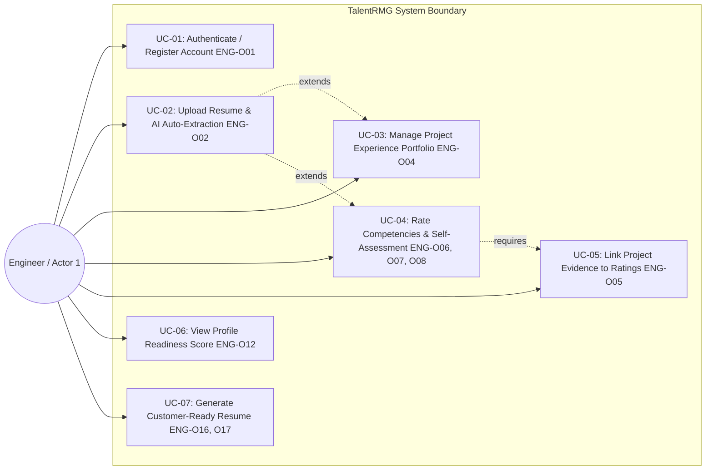
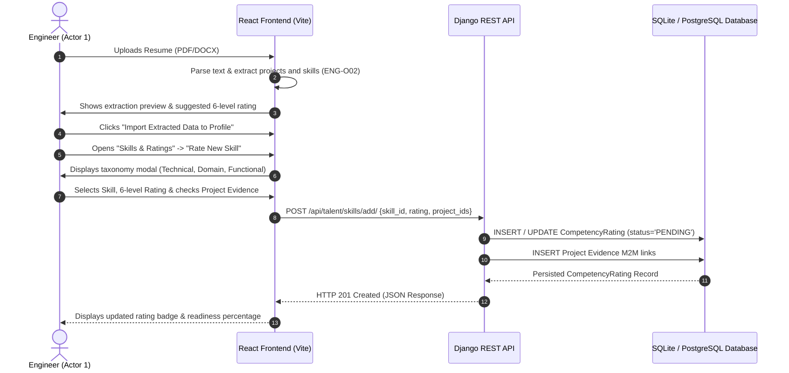
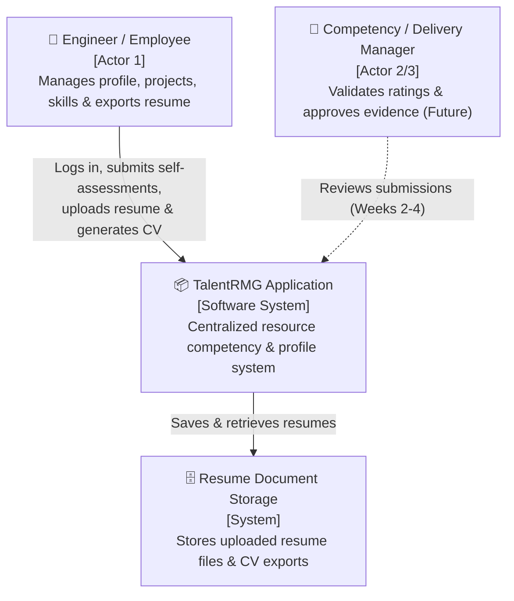
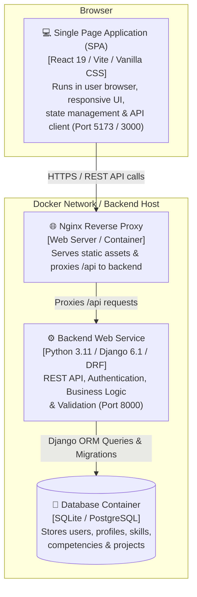

# Architecture, Design Patterns & Engineering Defense Documentation
**Project:** Talent Resource Management System (TalentRMG) — Actor 1: Engineer Portal  
**Scope:** Objectives `ENG-O01` through `ENG-O19`  
**Compliance Standard:** 4-Week Engineering Knowledge Rubric

---

## 1. UML Diagrams (Rule 2.1)

### 1.1 UML Use-Case Diagram (Actor 1: Engineer / Employee)


### 1.2 UML Sequence Diagram (Resume Ingestion & Evidence-Backed Skill Rating)


---

## 2. C4 Architecture Models (Rule 2.2)

### 2.1 C4 Level 1: System Context Diagram


### 2.2 C4 Level 2: Container Diagram


---

## 3. SOLID Principles & Concrete Applications (Rule 2.3)

| Principle | Meaning & Definition | Applied in TalentRMG Codebase |
| :--- | :--- | :--- |
| **S — Single Responsibility (SRP)** | A class/module should have only one reason to change. | **Applied in Component Deconstruction:** Separated monolithic `App.jsx` and `views.py` into dedicated, cohesive units: `auth_views.py` (auth only), `portal_views.py` (business CRUD only), `SkillsTable.jsx` (display only), `SkillRatingModal.jsx` (input modal only). |
| **O — Open / Closed (OCP)** | Software entities should be open for extension, but closed for modification. | **Applied in `DEFAULT_SKILL_TAXONOMY` & Dimension Routing:** Adding new dimensions or skill domains requires appending taxonomy items without altering table rendering logic or rating calculation functions. |
| **L — Liskov Substitution (LSP)** | Subtypes must be substitutable for their base types without altering correctness. | **Applied in DRF `ModelViewSet`:** Custom viewsets in `viewsets.py` inherit from DRF `ModelViewSet`, preserving full compatibility with Django router, serializer validation, and HTTP verb dispatch. |
| **I — Interface Segregation (ISP)** | Clients should not be forced to depend on interfaces they do not use. | **Applied in Modular React Props:** `SkillsTable` receives only `competencies`, `onEdit`, `onDelete`, instead of full application state or authentication tokens. |
| **D — Dependency Inversion (DIP)** | High-level modules should depend on abstractions, not low-level implementations. | **Applied in `api.js` Fallback Abstraction:** React UI components call standard async API signatures (`getProjectsApi()`, `submitCompetencyRatingApi()`); the client transparently handles live backend responses or mock fallbacks without leaking HTTP transport details to the UI. |

---

## 4. Design Pattern Implementation (Rule 2.4)

### Implemented Pattern: **Facade Pattern**
- **Location:** `backend/talent/views.py` & `frontend/src/api.js`
- **Purpose:** 
  - In `backend/talent/views.py`: Acts as a unified structural Facade that aggregates and exposes the decomposed sub-controllers (`auth_views.py`, `portal_views.py`, `viewsets.py`). This gives the URL router a clean, stable single point of entry while keeping individual implementation files strictly under 150 lines (SRP).
  - In `frontend/src/api.js`: Provides a high-level client facade over `fetch()`, authentication headers, CSRF tokens, and mock fallbacks. Components never make raw `fetch` calls.

---

## 5. Linux Practical Operations Guide (Rule 2.5)

The following 5 standard Linux operations cover the required operational competencies:

1. **Processes (`ps`, `top`, `kill`, `pkill`):**
   ```bash
   # Inspect running application processes
   ps aux | grep -E "python|nginx|node"
   # Gracefully terminate a rogue process
   kill -15 <PID>
   ```

2. **Permissions (`chmod`, `chown`, `umask`):**
   ```bash
   # Restrict secret credentials and database access
   chmod 600 backend/db.sqlite3
   # Set executable permissions on entrypoint script
   chmod +x docker-entrypoint.sh
   chown -R www-data:www-data /usr/share/nginx/html
   ```

3. **Networking (`netstat`, `ss`, `curl`, `ip`):**
   ```bash
   # Verify server port listening state
   ss -tulpn | grep -E "8000|3000|80"
   # Probe API health endpoint
   curl -I http://localhost:8000/api/talent/dashboard/
   ```

4. **Logs & Monitoring (`journalctl`, `tail`, `grep`):**
   ```bash
   # Follow live backend application logs in real-time
   tail -f -n 100 /var/log/talent_app.log
   # Filter for HTTP 500 errors or exceptions
   grep -i "error\|exception" /var/log/talent_app.log
   ```

5. **Environment Variables (`export`, `env`, `.env`):**
   ```bash
   # Set operational runtime configuration
   export DJANGO_SETTINGS_MODULE=core_api.settings
   export DEBUG=False
   # Print active environment values
   printenv | grep -E "DJANGO|NODE"
   ```

---

## 6. Viva Defense Guide (Rules 2.8 & 2.9)

### 6.1 Key Classes for Explanation

1. **`EmployeeProfile` (`backend/talent/models.py`)**:
   - One-to-one relationship with Django `User`.
   - Stores enterprise identifiers (`employee_id`), job title (`designation`), and organizational unit (`department`).
   - Serves as the foreign key anchor for all project experiences and competency ratings.

2. **`CompetencyRating` (`backend/talent/models.py`)**:
   - Represents an employee's proficiency level on a specific `Skill`.
   - Uses the standard 6-level rating choices (`ZERO`, `TRAINED`, `BEGINNER`, `INTERMEDIATE`, `ADVANCED`, `EXPERT`).
   - Tracks manager review status (`PENDING`, `APPROVED`, `REJECTED`).
   - Maintains a Many-to-Many (`ManyToManyField`) relation with `ProjectExperience` as verifiable evidence.

### 6.2 Key Functions for Explanation

1. **`signup_page()` (`backend/talent/auth_views.py`)**:
   - Parses incoming JSON payload from React signup form.
   - Validates password confirmation, duplicate usernames, and duplicate employee IDs.
   - Creates the Django `User` and linked `EmployeeProfile` in a single atomic transaction.

2. **`dashboard_view()` (`backend/talent/portal_views.py`)**:
   - Aggregates employee statistics: total ratings, approved count, pending count, and linked projects.
   - Computes profile completeness score to inform the UI progress meter.

3. **`handleImportExtractedData()` (`frontend/src/App.jsx`)**:
   - Receives structured data parsed from uploaded resume.
   - Deduplicates and maps skills to the organizational taxonomy codes (`DEFAULT_SKILL_TAXONOMY`).
   - Automatically links extracted projects as initial supporting evidence.

4. **`submitCompetencyRatingApi()` (`frontend/src/api.js`)**:
   - Dispatches POST request with credentials to submit self-assessment ratings.
   - Contains fallback logic to guarantee offline usability during local evaluation.

5. **`ResumePreview()` (`frontend/src/components/ResumePreview.jsx`)**:
   - Renders a customer-ready CV adhering to compliance rule `SYS-08`.
   - Strips internal numeric scores and manager validation feedback, presenting only verified skills, industries, and project outcomes.
