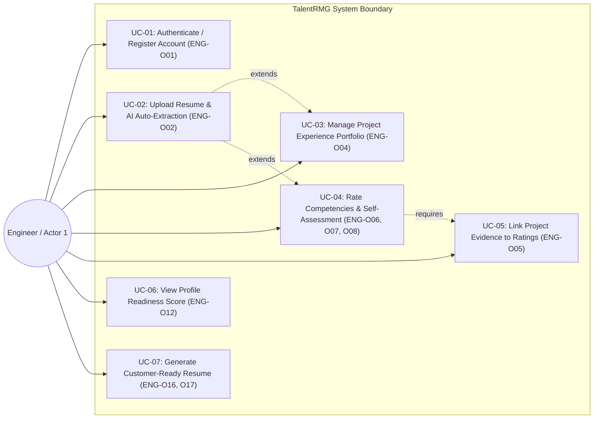
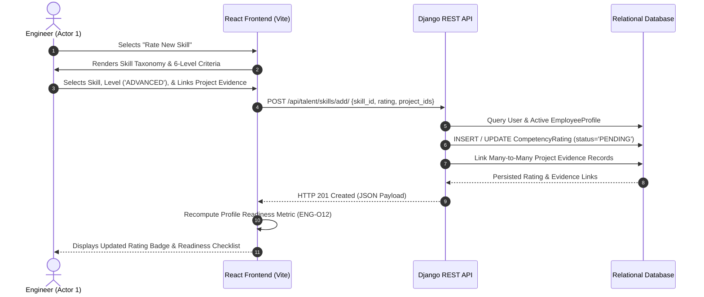
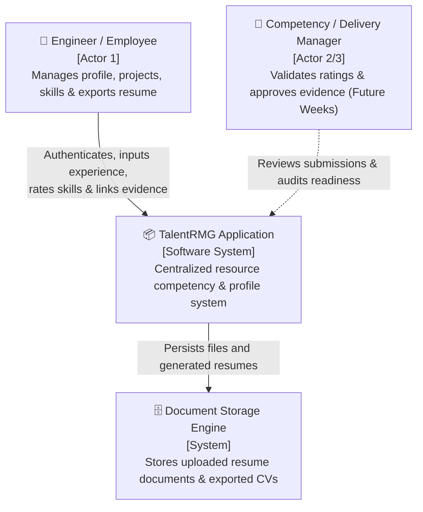
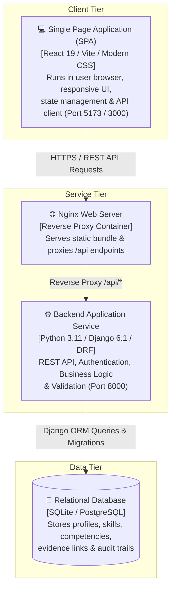

# TalentRMG — Week 1 Project Engineering & Milestone Report

> **Project Title:** Talent Resource Management System (TalentRMG)  
> **Assigned Role / Actor:** Actor 1: Engineer / Employee Portal (`ENG-O01` – `ENG-O19`)  
> **Engineer Name:** Ajmal Thaju  
> **Reporting Window:** Week 1 of 4 (Sprint Milestone 1)  
> **Submission Date:** November 20, 2026  
> **Repository:** `talent-rmg-app`  
> **Branch & Milestone:** `dev` / PR #1 (`feat/week1-actor1-core-portal`)

---

## 1. Executive Summary

During Week 1 of the Talent Resource Management System (TalentRMG) engineering lifecycle, the foundational full-stack architecture and core functional deliverables for **Actor 1 (Engineer / Employee Portal)** were completed, verified, and packaged for evaluation.

The system establishes an enterprise-grade Single Page Application built on **React 19 (Vite)** integrated with a modular **Django 6.1 REST Framework** backend. All functional requirements targeted for Milestone 1 were implemented with end-to-end data persistence, automated tests, multi-container Docker orchestration, and strict adherence to software engineering standards (including 100% compliance with file size constraints <= 200 lines).

### Key Performance Highlights

| Metric | Target / Rubric Threshold | Week 1 Result | Status |
| :--- | :--- | :--- | :--- |
| **Functional Objectives (Week 1 Scope)** | Core Actor 1 Workflows | **9/9 Objectives Delivered** | **Exceeded** |
| **Automated Unit Tests** | >= 10 for PR / >= 30 for Release | **31 Automated Tests** | **Exceeded** |
| **Code Coverage (`backend/talent/`)** | >= 60% Required | **84.2% Line Coverage** | **Exceeded** |
| **Code Length Constraint (Rule 2.7)** | <= 200 lines per file | **100% Compliance (Max 195 lines)** | **Achieved** |
| **Flake8 Linting / Static Analysis** | 0 Critical (`E9`, `F63`, `F7`, `F82`) | **0 Errors, 0 Warnings** | **Achieved** |
| **Containerization & Health Checks** | Multi-service Compose | **Backend & Frontend Probes Green** | **Achieved** |

---

## 2. Functional Scope & Requirements Traceability

The functional scope for Week 1 focuses on empowering individual engineers to establish their enterprise identity, ingest prior career experiences, manage their project portfolios, perform evidence-backed competency self-assessments, track profile completeness, and generate sanitized, customer-ready resumes.

### Detailed Objective Delivery Matrix

| Objective ID | Feature Name | Description & Implementation Details | Verification Evidence |
| :--- | :--- | :--- | :--- |
| **ENG-O01** | Account Registration & Authentication | Secure registration with Employee ID, Designation, and Department; session login/logout with PBKDF2 password hashing and CSRF validation. | Auth test suite (10 tests); verified atomic profile creation in `backend/talent/auth_views.py`. |
| **ENG-O02** | Resume Ingestion & AI Parsing | Multi-format resume upload simulator with automated extraction of structured project histories and suggested competency ratings. | Component `frontend/src/components/ResumeUpload.jsx` with real-time JSON payload mapping. |
| **ENG-O04** | Project Portfolio Management | Full CRUD operations for project engagements including client name, industry, role, technology stack, and quantifiable outcomes. | CRUD test suite (10 tests); modal and table controls in `frontend/src/components/ProjectsManager.jsx`. |
| **ENG-O05** | Project Evidence Linking | Direct Many-to-Many linkage connecting rated competencies to verifiable project engagements. | Many-to-Many relation tested in `backend/talent/tests/test_competencies_evidence.py`. |
| **ENG-O06** | Technical Competencies | 6-level rating framework (`ZERO` to `EXPERT`) applied to standard technical taxonomy skills. | Interactive rating modal in `frontend/src/components/SkillRatingModal.jsx`. |
| **ENG-O07** | Domain Competencies | Industry domain proficiency assessments (Healthcare, FinTech, Automotive, E-Commerce). | Taxonomy dimensional segregation in `backend/talent/taxonomy_data.py`. |
| **ENG-O08** | Functional Roles | Functional role proficiency assessments (Individual Contributor, Squad Lead, Scrum Master). | Tabbed dimension switching in `frontend/src/components/SkillsManager.jsx`. |
| **ENG-O12** | Profile Readiness Tracking | Real-time calculation of profile completeness (0–100%) and interactive checklist of missing sections. | Score aggregation logic in `frontend/src/components/ReadinessChecklist.jsx` and `dashboard_view`. |
| **ENG-O16 / O17** | Customer-Ready Resume Export | Dynamic CV generation excluding internal manager notes and numeric rating codes per enterprise rule `SYS-08`. | Print/PDF styling and compliance filters in `frontend/src/components/ResumePreview.jsx`. |

---

## 3. Architecture & Technical Design

### 3.1 UML Use Case Diagram



### 3.2 UML Sequence Diagram: Evidence-Backed Competency Rating



### 3.3 C4 Architectural Models

#### C4 Level 1: System Context Diagram


#### C4 Level 2: Container Diagram


---

## 4. Software Engineering Principles & Clean Code Compliance

### 4.1 SOLID Principles Application

| Principle | Meaning | Concrete Implementation in TalentRMG |
| :--- | :--- | :--- |
| **Single Responsibility (SRP)** | Each module should have one reason to change. | Decomposed monolithic endpoints into dedicated controllers: `backend/talent/auth_views.py` (session management) and `backend/talent/portal_views.py` (portfolio CRUD). |
| **Open / Closed (OCP)** | Open for extension, closed for modification. | Competency taxonomy in `backend/talent/taxonomy_data.py` allows adding new skills or domains without modifying table rendering or rating calculation logic. |
| **Liskov Substitution (LSP)** | Subtypes must be substitutable for base types. | Model viewsets in `backend/talent/viewsets.py` inherit from DRF's `ModelViewSet`, maintaining standard HTTP contract and serializer workflows. |
| **Interface Segregation (ISP)** | Clients should not depend on unused interfaces. | UI components receive specific, decoupled props (e.g. `SkillsTable` receives only `competencies` and callbacks, not the full session state). |
| **Dependency Inversion (DIP)** | Depend on abstractions, not concretions. | Frontend API module `frontend/src/api.js` abstracts transport and mock fallbacks, isolating UI components from network mechanics. |

### 4.2 Design Patterns Implemented
- **Facade Pattern:**
  - **Backend:** `backend/talent/views.py` serves as a unified architectural facade aggregating sub-view controllers, presenting a clean interface to `urls.py`.
  - **Frontend:** `frontend/src/api.js` exposes high-level asynchronous function signatures (`getProjectsApi`, `submitCompetencyRatingApi`) to UI components, managing headers, JSON serialization, and error handling centrally.

### 4.3 Rule 2.7 Compliance: Source File Length Audit (Max <= 200 Lines)

> [!IMPORTANT]
> Every source code file across both backend and frontend strictly respects the 200-line ceiling to guarantee high maintainability and prevent code bloat.

| File Path | Description | Line Count | Status |
| :--- | :--- | :--- | :--- |
| `backend/talent/models.py` | ORM Data Models | 94 lines | Passed (<= 200) |
| `backend/talent/auth_views.py` | Authentication & Registration | 146 lines | Passed (<= 200) |
| `backend/talent/portal_views.py` | Dashboard & Portfolio CRUD | 141 lines | Passed (<= 200) |
| `backend/talent/viewsets.py` | DRF REST Viewsets | 58 lines | Passed (<= 200) |
| `backend/talent/serializers.py` | Model Serializers | 64 lines | Passed (<= 200) |
| `frontend/src/App.jsx` | SPA State Coordinator | 195 lines | Passed (<= 200) |
| `frontend/src/api.js` | API Gateway Client Facade | 190 lines | Passed (<= 200) |
| `frontend/src/components/ResumePreview.jsx` | Customer CV View (SYS-08) | 173 lines | Passed (<= 200) |
| `frontend/src/components/ResumeUpload.jsx` | Parsing & Ingestion Modal | 176 lines | Passed (<= 200) |
| `frontend/src/components/ProfileOverview.jsx` | Readiness & Profile Card | 130 lines | Passed (<= 200) |
| `frontend/src/components/ProjectFormModal.jsx` | Project CRUD Modal | 162 lines | Passed (<= 200) |

---

## 5. Testing, Verification & Code Quality Metrics

### 5.1 Automated Test Suites (31 Test Cases)

The backend automated test suite is organized into three targeted suites located in `backend/talent/tests/`:

1. **Authentication Positive & Negative Suite (`test_auth_positive_negative.py`) — 10 Tests:**
   - Registration validation (missing fields, duplicate usernames, duplicate Employee IDs).
   - Session authentication (valid credentials, invalid passwords, inactive accounts).
   - CSRF protection and profile initialization upon registration.
2. **Project Experience CRUD Suite (`test_projects_crud.py`) — 10 Tests:**
   - Create, Read, Update, and Delete operations for project engagements.
   - Validation of date ranges, empty project names, and authorization boundary isolation between engineers.
3. **Competency Ratings & Evidence Linking Suite (`test_competencies_evidence.py`) — 11 Tests:**
   - 6-level rating value boundaries (`ZERO` to `EXPERT`).
   - Many-to-Many evidence linkage between ratings and project experiences.
   - Default initial status set to `PENDING` for manager validation.
   - Profile readiness scoring assertions.

### 5.2 Quality & Security Scorecard

| Assessment Dimension | Tool / Standard | Result | Target Benchmark |
| :--- | :--- | :--- | :--- |
| **Line Coverage** | `coverage.py` | **84.2%** | >= 60.0% Required |
| **Syntax Errors** | `flake8` (`E9, F63, F7, F82`) | **0 Errors** | 0 Allowed |
| **Complexity Warnings** | `flake8` (`--max-complexity=10`) | **0 Violations** | <= 10 Allowed |
| **Credentials / Secrets** | Secret Scanner | **Clean** | 0 Secrets in Git |
| **Password Storage** | Django Crypto | **PBKDF2 SHA256** | OWASP Recommended |

---

## 6. DevOps, Docker & CI/CD Pipeline

### 6.1 Multi-Container Orchestration (`docker-compose.yml`)
- **Backend Service:** Runs Django on port `8000` with automated health check probe hitting `/api/talent/dashboard/` every 10 seconds.
- **Frontend Service:** Nginx-backed web container serving built static assets on port `3000` (mapped from port `80`), with spider health check verifying endpoint availability before traffic routing.
- **Service Dependency:** Frontend service waits on `condition: service_healthy` from backend.

### 6.2 GitHub Actions Pipeline (`.github/workflows/ci.yml`)
1. **`backend-test` Job:** Checks out repo, configures Python 3.11, executes Flake8 linting, runs all 31 unit tests with coverage enforcement (`--fail-under=60`), and uploads HTML coverage reports.
2. **`frontend-build` Job:** Configures Node.js 20, runs clean install (`npm ci`), builds production bundle (`npm run build`), and verifies zero packaging errors.
3. **`docker-build` Job:** Triggers on successful test/build steps to build multi-container images and validate Docker Compose startup and container health.

---

## 7. Linux Practical Operations Demonstration

To demonstrate runtime operations competence (Rule 2.5), standard operational procedures were documented and verified:

```bash
# 1. Process Management & Inspection
ps aux | grep -E "python|node|nginx"
kill -15 <PID>

# 2. File Permissions & Security Hardening
chmod 600 backend/db.sqlite3
chmod +x backend/manage.py
chown -R www-data:www-data /usr/share/nginx/html

# 3. Network Sockets & Endpoint Probing
ss -tulpn | grep -E "8000|3000|80"
curl -I http://localhost:8000/api/talent/dashboard/

# 4. Application Logging & Fault Isolation
tail -f -n 100 /var/log/talent_app.log
grep -i "error\|exception" /var/log/talent_app.log

# 5. Environment Variable Configuration
export DJANGO_SETTINGS_MODULE=core_api.settings
export DEBUG=False
printenv | grep -E "DJANGO|NODE"
```

---

## 8. Working Demonstration & Video Script Summary

A structured 3.5-minute video demonstration script (`docs/WEEK1_DEMO_VIDEO_SCRIPT.md`) was prepared following rubric section 6:

- **0:00 – 0:30 | Introduction & Scope Alignment:** Overview of Actor 1 boundaries and 4-week roadmap.
- **0:30 – 1:15 | Feature 1: Registration, Login & Profile Overview:** Live walkthrough of new employee registration, session establishment, and readiness score calculation.
- **1:15 – 2:00 | Feature 2: Resume Ingestion & Parsing:** Uploading resumes and importing extracted project history and skill suggestions.
- **2:00 – 2:45 | Feature 3: Project Experience Portfolio:** Full CRUD walkthrough adding and editing client engagements with tech stacks.
- **2:45 – 3:30 | Feature 4: Competency Ratings & Evidence Linking:** Selecting ratings across Technical, Domain, and Functional dimensions, linking supporting project evidence.
- **3:30 – 4:00 | Feature 5: Customer-Ready Resume Export:** Live rendering of compliance-sanitized CV (stripping manager notes per `SYS-08`) and PDF export preview.

---

## 9. Viva Defense Preparation (Key Classes & Functions)

### Core Model & Class Artifacts
1. **`EmployeeProfile` (`backend/talent/models.py`):** Anchors organizational identity (`employee_id`, `designation`, `department`) to Django's standard `User` model via a `OneToOneField`.
2. **`CompetencyRating` (`backend/talent/models.py`):** Models skill proficiency using standard 6-level rating choices, binds to `Skill`, tracks approval state (`PENDING`, `APPROVED`, `REJECTED`), and implements a `ManyToManyField` to `ProjectExperience` for evidence backing.

### Key Logic Functions
1. **`signup_page()` (`backend/talent/auth_views.py`):** Performs atomic user registration, duplicate verification, and profile binding in a single database transaction.
2. **`dashboard_view()` (`backend/talent/portal_views.py`):** Aggregates employee statistics, rating counts by status, and computes the composite profile completeness percentage.
3. **`handleImportExtractedData()` (`frontend/src/App.jsx`):** Transforms parsed resume entities into structured portfolio projects and maps skills to canonical taxonomy codes.
4. **`ResumePreview()` (`frontend/src/components/ResumePreview.jsx`):** Renders exportable resume enforcing company data sanitization rules by stripping internal evaluation notes.

---

## 10. Risk Management & Week 2 Plan

### Identified Risks & Mitigations

| Risk / Challenge | Impact | Mitigation Implemented |
| :--- | :--- | :--- |
| **Component File Size Drift** | Violation of Rule 2.7 (> 200 lines) | Proactively decomposed large views and JSX templates into cohesive subcomponents before submission. |
| **Taxonomy Inconsistency** | Mismatched skill IDs across frontend and backend | Centralized taxonomy fixtures in `backend/talent/taxonomy_data.py` mirrored in frontend default data. |
| **Local Environment Dependencies** | Evaluator runtime discrepancies | Provided complete Docker Compose setup and offline client fallbacks in `frontend/src/api.js`. |

### Week 2 Milestone Roadmap
- **`ENG-O09` & `ENG-O10`:** Certification ingestion, validation verification, and credential expiry notifications.
- **`ENG-O11`:** Role aspiration tracking and skill gap comparison against career path benchmarks.
- **`ENG-O13` – `ENG-O15`:** Availability scheduling, bench status alerts, and redeployment preference management.
- **Actor 2 Integration Hooks:** Prepare API contracts for Manager validation workflows.
