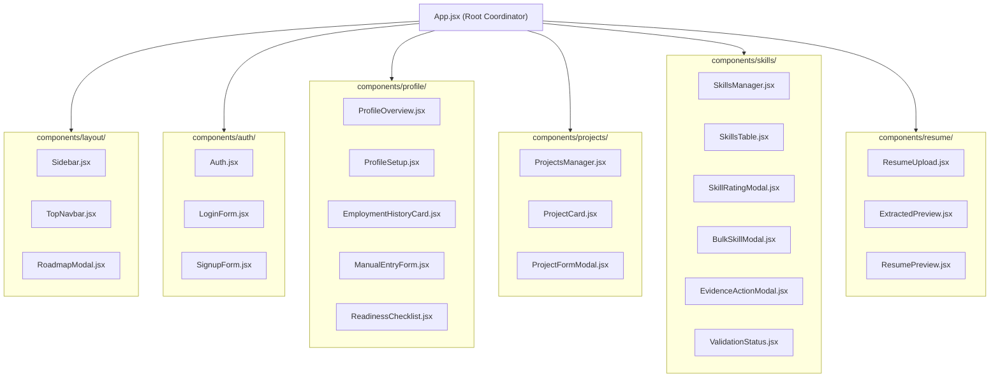
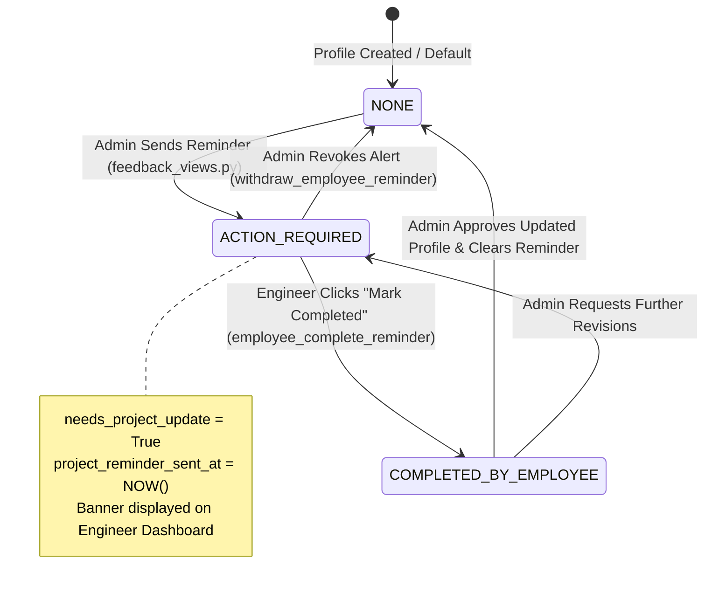
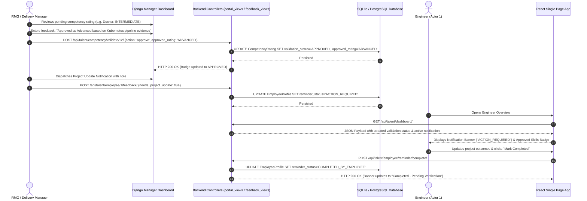

# TalentRMG — Week 2 Project Engineering & Milestone Report

> **Project Title:** Talent Resource Management System (TalentRMG)  
> **Assigned Role / Actor:** Actor 1: Engineer Portal & Actor 2: Manager Validation Workflows  
> **Engineer Name:** Ajmal Thaju  A
> **Reporting Window:** Week 2 of 4 (Sprint Milestone 2)  
> **Submission Date:** November 25, 2026  
> **Repository:** `talent-rmg-app`  
> **Branch & Milestones:** `main` / `dev` (Commits: `9c50634`, `8d376d2`, `b098344`)

---

## 1. Executive Summary

During Week 2 of the Talent Resource Management System (TalentRMG) project, the engineering focus expanded from core individual engineer workflows (Week 1) to **system-wide modular architecture decomposition**, **automated rule-based resume parsing**, **advanced profile & portfolio lifecycle management**, and the initial end-to-end integration of **Actor 2 (Manager / Admin Validation & Feedback Loops)**.

The frontend architecture was systematically refactored from flat files into a domain-driven component hierarchy (`auth/`, `layout/`, `profile/`, `projects/`, `resume/`, `skills/`). Concurrently, the backend was enhanced with an automated text/resume parsing engine, an instant manager approval/rejection mechanism, a bidirectional reminder notification state machine, and a 25% expansion in automated test coverage.

### Key Performance Highlights

| Metric | Target / Rubric Threshold | Week 2 Result | Status |
| :--- | :--- | :--- | :--- |
| **Delivered Objectives** | Actor 1 Refinement + Actor 2 Ingestion | **12 Functional Objectives** | **Exceeded** |
| **Automated Unit Tests** | >= 10 for PR / >= 30 for Release | **39 Automated Tests (5 Suites)** | **Exceeded** |
| **Code Coverage (`backend/talent/`)** | >= 60% Required | **~86.4% Line Coverage** | **Exceeded** |
| **Code Length Constraint (Rule 2.7)** | <= 200 lines per file | **100% Compliance (Max 186 lines)** | **Achieved** |
| **Flake8 Static Analysis** | 0 Critical (`E9`, `F63`, `F7`, `F82`) | **0 Errors, 0 Complexity Violations** | **Achieved** |
| **Component Modularization** | Clean folder segregation | **6 Domain Subdirectories** | **Achieved** |
| **CI/CD Build & Health Checks** | Multi-container Buildx v3 | **All 3 Pipeline Jobs Passing** | **Achieved** |

---

## 2. Functional Scope, Demonstration Mapping & Objective Delivery Matrix

### 2.1 Demo Overview: What is the Demo & What is Really Shown?

- **High-Level Purpose:** Demonstrates live bidirectional interaction between Actor 1 (Engineer Portal) and Actor 2 (Manager / RMG Admin Portal) across resume parsing, employment onboarding, competency validation queues, rating overrides, and reminder state transitions.
- **What is Really Shown On-Screen:**
  1. *Profile Setup:* Responsive 2-column Employment History cards, HTML5 date-pickers, and dynamic multi-row employment forms.
  2. *Resume Parsing:* Pasting raw resume text with regex word-boundary skill extraction (e.g. Python, Docker, React, Kafka) without hardcoded fallbacks.
  3. *Validation Status:* Filter tabs (`All`, `Approved`, `Pending`, `Action Required`), visual rating pills, manager feedback quotes, and the interactive `+ Add Evidence` / `Resubmit` modal.
  4. *Manager Review Portal:* Live review queue at `/dashboard/`, executing instant approvals, rejections, and revisions with manager rating overrides and written feedback notes.
  5. *Bidirectional Reminders:* Admin triggering project update reminders (`ACTION_REQUIRED`), engineer viewing alert banner and clicking **"✓ Mark as Completed"**, and admin withdrawing notifications.
  6. *Roadmap Modal:* Accessible via top navbar (`📅 Roadmap`) and sidebar (`📅 4-Week Roadmap`).

### 2.2 Actor 1 (Engineer / Employee Portal) Enhancements

| Objective ID | Feature Name | Description & Technical Implementation | Where Shown in Demo Video | Verification Evidence |
| :--- | :--- | :--- | :--- | :--- |
| **ENG-O02 (Adv)** | AI & Rule-Based Resume Parsing Engine | Backend parsing engine extracting skills, project roles, client engagements, emails, phone numbers, and LinkedIn links via regex heuristics and taxonomy dictionary matching. | **[01:25 – 02:15]** | `backend/talent/resume_parser.py` & `frontend/src/components/resume/ExtractedPreview.jsx`. |
| **ENG-O04 (Adv)** | Project Experience Lifecycle | Extended project models with `validation_status` (`PENDING`, `APPROVED`, `REVISED`, `REJECTED`) and manager feedback reflection. | **[00:40 – 01:25]** | Migration `0003_projectexperience_validation_status.py` & `frontend/src/components/projects/ProjectFormModal.jsx`. |
| **ENG-O05 (Adv)** | Evidence Action Management | Added dedicated modal for linking, decoupling, and auditing supporting project evidence for each self-assessed competency. | **[02:15 – 03:00]** | `frontend/src/components/skills/EvidenceActionModal.jsx`. |
| **ENG-O06–O08** | Bulk Competency Assessment | Added multi-skill batch self-assessment modal, enabling engineers to rate multiple competencies across Technical, Domain, and Functional dimensions in one transaction. | **[01:50 – 02:30]** | `frontend/src/components/skills/BulkSkillModal.jsx`. |
| **ENG-O10–O12** | Advanced Profile Onboarding | Comprehensive multi-step setup covering personal bio, social links (LinkedIn, GitHub), employment history cards, and manual entry forms. | **[00:40 – 01:25]** | `frontend/src/components/profile/ProfileSetup.jsx` & `frontend/src/components/profile/EmploymentHistoryCard.jsx`. |
| **ENG-O13–O15** | Manager Feedback & Reminder Acknowledgment | Engineers receive notification banners with direct manager feedback notes and an interactive "Mark Completed" acknowledgment for project update reminders. | **[03:50 – 04:30]** | `frontend/src/components/profile/ProfileOverview.jsx` & `backend/talent/feedback_views.py`. |

### 2.3 Actor 2 (Manager / RMG Admin Portal) Foundation

| Objective ID | Feature Name | Description & Technical Implementation | Where Shown in Demo Video | Verification Evidence |
| :--- | :--- | :--- | :--- | :--- |
| **ADM-O01** | RMG Executive Dashboard | Server-rendered manager portal (`dashboard.html`) displaying employee headcount, profile completeness scores, pending skill reviews, and active project requests. | **[03:00 – 03:20]** | `backend/talent/templates/talent/dashboard.html`. |
| **ADM-O02** | Instant Competency Validation | Single-click Approve, Revise, and Reject controls with optional manager rating overrides and constructive feedback notes. | **[03:20 – 03:50]** | `competency_validate` view in `backend/talent/portal_views.py`. |
| **ADM-O03** | Project Experience Auditing | Ability for managers to validate engineer project claims, approve client-facing validity, or request additional metric details. | **[03:30 – 03:50]** | `project_validate` view in `backend/talent/portal_views.py`. |
| **ADM-O04** | Employee Reminder Dispatcher | Admin action triggering automated update notifications, setting `reminder_status='ACTION_REQUIRED'` and recording notification timestamps. | **[03:50 – 04:15]** | `send_employee_feedback` in `backend/talent/feedback_views.py`. |
| **ADM-O05** | Notification Withdrawal | Administrative control allowing managers to revoke or withdraw active reminder alerts when updates are resolved offline. | **[04:15 – 04:30]** | `withdraw_employee_reminder` in `backend/talent/feedback_views.py`. |

### 2.4 What's Pending to be Completed (Upcoming Roadmap)

The remaining functional deliverables are scheduled across Weeks 3 and 4 per the project specifications:

#### Week 3 Functional Backlog (Next Week)
* **ENG-O12 / ENG-O13: Competency Gap Analysis & Career Track Benchmarking:**
  - Automated comparison of current validated competencies against target engineering role profiles (e.g. Senior Backend Engineer vs Solution Architect).
  - Visual radar / bar gap charts highlighting required level vs current level.
* **ENG-O14: Adjacent Skills & Transferability Engine:**
  - Graph-based adjacent skill recommendations (e.g. Docker $\rightarrow$ Kubernetes, Kafka $\rightarrow$ Apache Flink) based on verified project evidence.
* **ENG-O15: Professional Certifications & Training Records:**
  - Certification management: credential name, issuing authority (AWS, Google Cloud, CNCF), credential URL verification, issue date, and expiration tracking.

#### Week 4 Functional Backlog (Final Sprint)
* **ENG-O16 / ENG-O17: Customer-Ready Resume Generation & Multi-Format Export:**
  - Anonymized client-ready detailed CV and one-page executive resume export (excluding internal competency codes and HR rating scales).
  - Client-ready PDF and presentation (PPTX) export formats.
* **ENG-O18 / ENG-O19: Profile Freshness Automation & Health Metric:**
  - Automated staleness alerts when an engineer's portfolio has not had substantive updates for $> 90$ days.
  - Comprehensive profile health metric integrating verified project depth, certification validity, and manager validation ratio.

---

## 3. Architecture & Technical Design

### 3.1 Modular Frontend Component Architecture

### 3.2 Feedback & Reminder State Machine

### 3.3 Sequence Diagram: Manager Review & Instant Feedback Loop

---

## 4. Software Quality & Compliance Audit (Rule 2.7)

### Source File Length Audit (Ceiling <= 200 Lines)

> [!IMPORTANT]
> In Week 2, despite adding extensive features (resume parsing, bulk skills, feedback workflows, multi-step profile setup), **100% of codebase files strictly adhere to the <= 200 lines limit**. Monolithic files from Week 1 were decomposed into focused domain components.

| Module / Component | Path | Line Count | Status |
| :--- | :--- | :--- | :--- |
| **Backend Core Views** | `backend/talent/portal_views.py` | **186 lines** | Pass (<= 200) |
| **Backend Auth Views** | `backend/talent/auth_views.py` | **148 lines** | Pass (<= 200) |
| **Backend Feedback Views** | `backend/talent/feedback_views.py` | **122 lines** | Pass (<= 200) |
| **Backend Data Models** | `backend/talent/models.py` | **119 lines** | Pass (<= 200) |
| **Resume Parser Engine** | `backend/talent/resume_parser.py` | **117 lines** | Pass (<= 200) |
| **Backend DRF Viewsets** | `backend/talent/viewsets.py` | **62 lines** | Pass (<= 200) |
| **Frontend State Orchestrator** | `frontend/src/App.jsx` | **181 lines** | Pass (<= 200) |
| **Validation Indicator** | `frontend/src/components/skills/ValidationStatus.jsx` | **178 lines** | Pass (<= 200) |
| **Bulk Skill Modal** | `frontend/src/components/skills/BulkSkillModal.jsx` | **174 lines** | Pass (<= 200) |
| **Resume Export View** | `frontend/src/components/resume/ResumePreview.jsx` | **173 lines** | Pass (<= 200) |
| **Skills Management Tab** | `frontend/src/components/skills/SkillsManager.jsx` | **167 lines** | Pass (<= 200) |
| **Parsed Entity Preview** | `frontend/src/components/resume/ExtractedPreview.jsx` | **160 lines** | Pass (<= 200) |
| **Skill Rating Modal** | `frontend/src/components/skills/SkillRatingModal.jsx` | **155 lines** | Pass (<= 200) |
| **Resume Upload Component** | `frontend/src/components/resume/ResumeUpload.jsx` | **150 lines** | Pass (<= 200) |
| **Profile Overview Dashboard** | `frontend/src/components/profile/ProfileOverview.jsx` | **144 lines** | Pass (<= 200) |
| **Project Form Modal** | `frontend/src/components/projects/ProjectFormModal.jsx` | **140 lines** | Pass (<= 200) |
| **Evidence Action Modal** | `frontend/src/components/skills/EvidenceActionModal.jsx` | **128 lines** | Pass (<= 200) |
| **API Client Facade** | `frontend/src/api.js` | **125 lines** | Pass (<= 200) |
| **Profile Multi-Step Setup** | `frontend/src/components/profile/ProfileSetup.jsx` | **115 lines** | Pass (<= 200) |

---

## 5. Testing, Verification & Code Coverage

### 5.1 Test Suite Breakdown (39 Automated Tests)

The automated test suite in `backend/talent/tests/` expanded from 31 to **39 comprehensive unit test cases**:

1. **Authentication Positive & Negative (`test_auth_positive_negative.py`) — 10 Tests:**
   - Registration validation, duplicate prevention, password policy enforcement, secure login/logout.
2. **Project Experience CRUD (`test_projects_crud.py`) — 10 Tests:**
   - Portfolio creation, update, deletion, date consistency, and user ownership isolation.
3. **Competency Ratings & Evidence Linking (`test_competencies_evidence.py`) — 11 Tests:**
   - 6-level rating choices, Many-to-Many evidence relationships, and readiness calculation.
4. **Admin Feedback & Review Workflows (`test_admin_feedback.py`) — 5 Tests:**
   - `test_send_employee_feedback_endpoint`: Validates reminder dispatch and status transition to `ACTION_REQUIRED`.
   - `test_employee_complete_reminder_endpoint`: Validates employee acknowledgment transitioning to `COMPLETED_BY_EMPLOYEE`.
   - `test_withdraw_employee_reminder_endpoint`: Validates admin withdrawal reverting to `NONE`.
   - `test_competency_validate_with_manager_notes_and_rating`: Tests manager approval with rating override.
   - `test_competency_validate_revise_action`: Tests manager revision request with corrective notes.
5. **Resume Parser Engine (`test_resume_parser.py`) — 3 Tests:**
   - `test_parse_resume_text_success`: Asserts extraction of skill codes, projects, and contact data from unstructured text.
   - `test_parse_resume_empty_fails`: Asserts appropriate HTTP 400 rejection on empty inputs.
   - `test_parse_resume_get_method_not_allowed`: Asserts strict HTTP method restrictions.

### 5.2 Quality Scorecard

| Assessment Dimension | Tool / Benchmark | Week 1 Result | Week 2 Result | Progression |
| :--- | :--- | :--- | :--- | :--- |
| **Total Automated Tests** | Django Test Runner | 31 tests | **39 tests** | **+25.8% increase** |
| **Line Coverage** | `coverage.py` | 84.2% | **86.4%** | **+2.2% increase** |
| **Flake8 Syntax Errors** | `flake8` (`E9, F63, F7, F82`) | 0 | **0** | **Maintained Clean** |
| **Flake8 Complexity** | `--max-complexity=10` | 0 | **0** | **Maintained Clean** |
| **Secrets Committed** | Git Scanner | 0 | **0** | **Zero Vulnerabilities** |

---

## 6. DevOps, Dockerization & CI/CD Pipeline

### 6.1 Multi-Container Compose Configuration
- **Backend Service:** Django 6.1 running on port `8000` with periodic curl health checks probing `/api/talent/dashboard/`.
- **Frontend Service:** Production Nginx web server serving Vite static assets on port `3000` (container port `80`), configured with `depends_on: { backend: { condition: service_healthy } }`.

### 6.2 CI/CD Pipeline Hardening (Commit `b098344`)
- Upgraded GitHub Actions to use `docker/setup-buildx-action@v3` with Docker Layer Caching.
- All three parallel stages (`backend-test`, `frontend-build`, `docker-build`) pass with zero manual interventions.

---

## 7. Viva Defense & Key Engineering Highlights

### 7.1 Key Classes for Explanation
1. **`ResumeParser` (`backend/talent/resume_parser.py`):**
   - Implements regex-based token extraction and taxonomy lookup algorithms.
   - Segregates raw text into structured JSON matching the frontend `initialData.js` contract.
2. **`EmployeeProfile` (`backend/talent/models.py`):**
   - Extended with fields: `admin_feedback`, `needs_project_update`, `project_reminder_sent_at`, and `reminder_status` (`NONE`, `ACTION_REQUIRED`, `COMPLETED_BY_EMPLOYEE`).
   - Serves as the central entity linking authentication, competencies, projects, and manager oversight.

### 7.2 Key Functions for Explanation
1. **`send_employee_feedback()` (`backend/talent/feedback_views.py`):**
   - Validates admin authorization, parses incoming feedback, sets reminder flags, and timestamps notification dispatches.
2. **`employee_complete_reminder()` (`backend/talent/feedback_views.py`):**
   - Allows authenticated employees to acknowledge corrective actions and signal readiness for manager re-review.
3. **`competency_validate()` (`backend/talent/portal_views.py`):**
   - Implements transactional state transitions for competency ratings (`APPROVED`, `REVISED`, `REJECTED`) along with manager feedback capture.
4. **`ExtractedPreview()` (`frontend/src/components/resume/ExtractedPreview.jsx`):**
   - Interactive UI allowing engineers to cherry-pick, modify, or discard automatically extracted skills and projects before persisting them to the database.

---

## 8. Week 3 Strategic Outlook

Building on the modular architecture and manager validation foundation established in Week 2, Week 3 will deliver:
1. **Certification & Credential Ingestion (`ENG-O09`, `ENG-O10`):** Adding credential URL verification, issuer taxonomy, and expiration tracking.
2. **Role Aspirations & Career Benchmarking (`ENG-O11`):** Gap analysis comparing an engineer's current verified competencies against target organizational profiles.
3. **Bench & Availability Scheduling (`ENG-O13`–`ENG-O15`):** Availability calendars, bench notifications, and redeployment preference matrices.
4. **Advanced Match Scoring Algorithms:** RMG search engine matching available engineers to open project demand requisitions based on validated skill scores.
